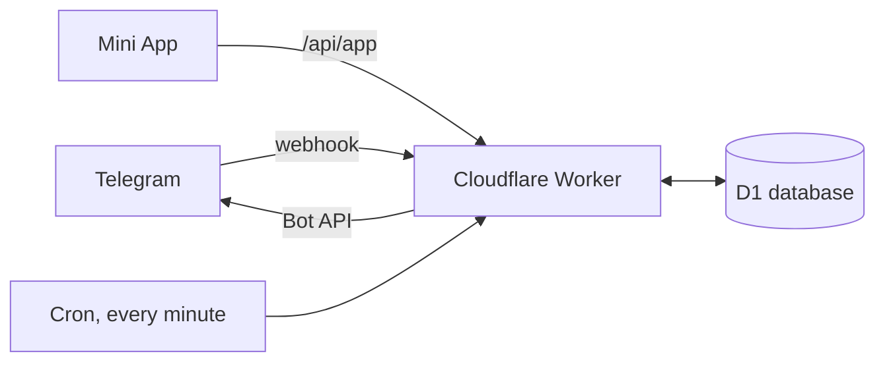

<p align="center">
  
</p>

<h1 align="center">SquashBot</h1>

<p align="center">
  A Telegram group bot that keeps a squash group's court bookings, rosters and money on one pinned board.
</p>

<p align="center">
  <a href="https://github.com/nicholas-wan/squash-bot/actions/workflows/test.yml"></a>
</p>

<p align="center">
  <a href="https://nicholaswan.me/projects">Interactive demo</a> ·
  <a href="docs/design.md">Design notes</a> ·
  <a href="docs/operations.md">Operations</a>
</p>

SquashBot runs on Cloudflare Workers with a D1 database. Someone books a court
by typing it the way they would say it, the bot pins a board of upcoming courts
in the group, players join or leave with a button, and once a court has been
played its cost is split and added to a running tab.

## Features

- **Plain-language booking.** `tmr c4 2100` or `Friday 8pm-9:30pm, Court 2`
  becomes a booking. Anything missing or ambiguous is asked with buttons, and
  nothing is saved until it is confirmed.
- **One pinned board.** Every upcoming court with its free slots, kept up to
  date in place rather than reposted.
- **Join and leave with a tap.** A private list per person, plus a silent
  "next available court" message pointing at the earliest court with room.
- **Cost splitting and a tab.** Courts are charged once played, at peak and
  off-peak rates, split across the roster and recorded in an append-only
  ledger. A second pinned message shows who owes what.
- **Reminders and monthly notices.** Players are reminded before their court,
  and larger balances get a private, itemised notice once a month.
- **Private by default.** Forms, receipts and reminders are ephemeral
  messages that only the recipient sees.
- **Admin tools.** Seat or remove players, open extra slots, record who booked,
  settle balances, and add or undo one-off `/debt` entries.
- **Mini App.** A Telegram Mini App for managing courts and the tab from a
  phone.

## How it works



- **Webhook** (`POST /webhook`): messages, button taps and membership changes
  from Telegram. Each update is handled once, even if Telegram redelivers it.
- **Cron**: a once-a-minute maintenance pass sends reminders, charges finished
  courts, refreshes the board and cleans up old messages. It skips the work
  when nothing is due.
- **Mini App**: a static page served from `public/app/`. Its requests are
  checked against Telegram's signed launch data and the user's group
  membership.
- **D1**: bookings, rosters, the ledger and scheduled work. The Worker is
  placed in Europe, next to the database and Telegram's servers.

## Getting started

### Prerequisites

- Node.js 24 (the tests use `node:sqlite`)
- A Cloudflare account with Workers and D1
- A Telegram bot from [@BotFather](https://t.me/BotFather)

### Set up

1. In BotFather, turn off Group Privacy with `/setprivacy`.
2. Add the bot to each group as an admin with **Pin Messages** and
   **Delete Messages**.
3. Install, configure and create the database:

   ```powershell
   npm install
   Copy-Item wrangler.example.toml wrangler.toml
   npx wrangler login
   npx wrangler d1 create squashbot-eu --location weur
   ```

   Put the new database's id in `wrangler.toml` under `[[d1_databases]]`, set
   `database_name = "squashbot-eu"` to match the npm scripts, and fill in the
   [configuration](#configuration).

4. Create the tables, add the secrets and deploy:

   ```powershell
   npm run db:init
   npx wrangler secret put BOT_TOKEN
   npx wrangler secret put WEBHOOK_SECRET
   npx wrangler secret put ADMIN_SECRET
   npm run deploy
   ```

   `npm run deploy` runs the test suite first and refuses to ship if it fails.

5. Register the webhook, command menus and bot name:

   ```powershell
   curl.exe -X POST -H "Authorization: Bearer YOUR_ADMIN_SECRET" `
     https://YOUR-WORKER.workers.dev/setup
   ```

An existing database also needs the numbered migrations; see
[Upgrading a live database](docs/operations.md#upgrading-a-live-database).

### Admin endpoints

All except the health check are `POST` and need
`Authorization: Bearer <ADMIN_SECRET>`.

| Path | What it does |
|---|---|
| `/setup` | Registers the webhook, command menus and bot name |
| `/refresh` | Rebuilds the board and tab in every allowed chat |
| `/profile-photo` | Sets the bot's profile photo from `assets/squashbot-logo.jpg` |
| `/` | Health check: 200 while the every-minute maintenance pass is succeeding, 500 once the last good pass is five minutes old |

## Configuration

Set these under `[vars]` in `wrangler.toml`. `wrangler.example.toml` has a
commented example of each.

| Variable | Purpose |
|---|---|
| `ALLOWED_CHATS` | Comma-separated group ids the bot answers in. Every other chat is ignored |
| `OWNER`, `OWNER_NAME` | Who pays for the courts. Always an admin, never billed |
| `OWNER_USER_ID` | Recommended. The owner's numeric Telegram id, so a username change cannot pass their rights to someone else |
| `DEFAULT_PLAYERS` | Seated on every new booking and never billed, as `id:@handle` entries |
| `UNBILLED_PLAYERS` | Optional. Never billed, but not seated automatically |
| `DEFAULT_CAPACITY` | Players per court before an admin opens more slots (default 3) |
| `DEFAULT_TIMEZONE` | Club timezone (default `Asia/Singapore`) |
| `DATA_CHAT_ID` | Optional. Lets several groups share one set of bookings and one tab |
| `PUBLIC_HOLIDAYS` | Optional. `YYYY-MM-DD` list that replaces the built-in holiday list |
| `TAB_NOTICE_MIN` | Optional. Balance in dollars from which the monthly notice is sent (default 20) |
| `TAB_NOTICE_FALLBACK_DAY` | Optional. Day of the month an uncollected notice is sent anyway (default 7; 0 turns it off) |
| `MINI_APP_URL` | Optional. The Mini App's BotFather link; adds a ⚙️ Manage button to the board |

Secrets, set with `npx wrangler secret put`:

| Secret | Purpose |
|---|---|
| `BOT_TOKEN` | The bot's token from BotFather |
| `WEBHOOK_SECRET` | Checked on every webhook call. Letters, numbers, `_` and `-` only |
| `ADMIN_SECRET` | Protects the admin endpoints |

The D1 database is bound as `DB`. Court rates and the Singapore public holiday
list live in `src/pricing.js`. Every option is described in full in
[docs/operations.md](docs/operations.md#configuration).

## Usage

Group admins can post a booking as an ordinary message. Everyone else puts the
same words after `/book`, which keeps the request out of the group:

```text
13 Aug Court 4 9pm
court four tomorrow at 9pm
Friday 8pm-9:30pm, Court 2
tmr c4 2100
```

No end time means one hour. The bot replies privately with a form to confirm,
then updates the pinned board.

| Command | Who | What it does |
|---|---|---|
| `/book [details] [@player or +1]` | Everyone | Add a booking; tag a player or bring a guest |
| `/courts` | Everyone | Refresh the pinned board |
| `/tab` | Everyone | Refresh the pinned tab, or show your own breakdown once everyone has settled |
| `/help`, `/start` | Everyone | Show examples |
| `/cancel ID` | Booker or admin | Remove a booking |
| `/debt +2 player reason` | Admins | Add to or take off what someone owes, after a confirmation step |
| `/debt undo` | Admins | Remove a recent `/debt` entry made by mistake |

## Testing

```powershell
npm test
```

The suite uses [Vitest](https://vitest.dev/) and runs the database tests
against an in-memory SQLite copy of the schema. GitHub Actions runs it on every
push and pull request.

## Project structure

```text
src/
  index.js        Webhook, cron and HTTP routes
  parser.js       Reads free-text bookings
  wizard.js       Booking and edit forms
  bookings.js     Bookings, the pinned board, rosters, reminders, maintenance
  tab.js          The pinned tab, ledger, settlements and /debt
  pricing.js      Court rates and public holidays
  miniapp-*.js    Mini App API, sign-in check and links
  ...
public/app/       The Mini App page
schema.sql        Full database schema, safe to re-run
migrations/       Upgrades for databases created before a change
test/             Vitest suites
docs/             Design notes, operations and known gaps
```

## Further reading

The detailed notes that used to fill this README now live in `docs/`:

- [docs/design.md](docs/design.md): how the board, money, privacy and
  commands behave, and why
- [docs/operations.md](docs/operations.md): configuration in full, deployment
  notes, the maintenance cron, Mini App handling and database upgrades
- [docs/known-gaps.md](docs/known-gaps.md): known limitations found in review
